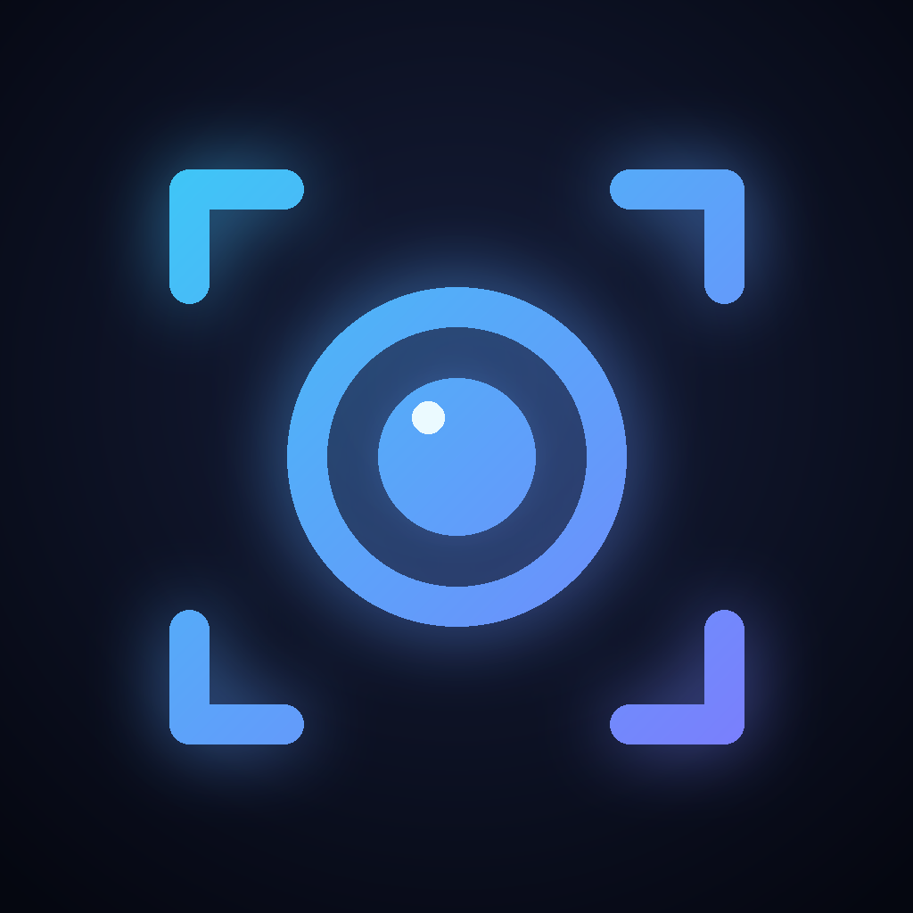
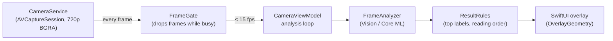
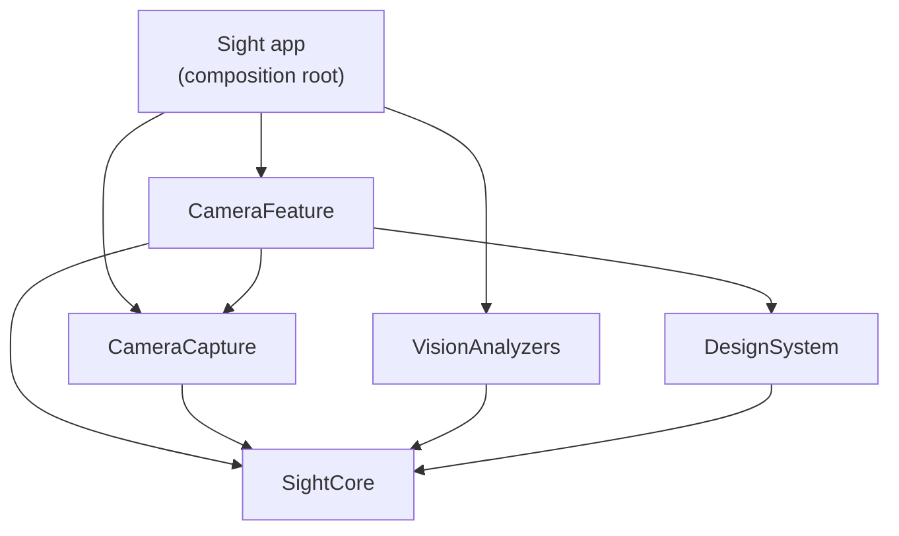

<p align="center">
  
</p>

<h1 align="center">Sight</h1>

<p align="center">
  An on-device AI camera for iPhone. Point it at something and it tells you what it is, boxes every object it finds, reads any text and lifts subjects into stickers, all on device with no network.
  Built with Vision, Core ML, AVFoundation and SwiftUI.
</p>

<p align="center">
  
  
  
  
  
  
  
</p>

---

## Features

- **Classify**: Apple's built-in image classifier names what the camera sees ("Coffee mug 91%") and shows the top three labels with confidence bars.
- **Objects**: a Core ML object detector (YOLOv3 Tiny, 80 kinds of objects) draws a labeled box around every person, cup, laptop or pet it finds, and the card counts them ("Cup ×2").
- **Text**: live text recognition outlines every line it reads on the camera image. Pause to freeze the result, then copy all the text in reading order.
- **Cutout**: lift the subject out of a photo or a captured camera frame, like long-pressing in the Photos app. It appears as a sticker with a white outline, and Share exports a transparent PNG (Save Image, Messages, anywhere).
- **Photos mode**: pick any photo and analyze it with the more accurate models. Rotated photos are handled through their EXIF orientation. On the simulator, which has no camera, this is the way to try the app.
- **Live performance meter**: analyzed frames per second and per-frame latency, measured on the device.
- **Private by design**: every model runs on the iPhone. Nothing is uploaded, and the app has no network code at all.

### Roadmap

| Stage | | Status |
|---|---|:--:|
| 1 | Camera, Classify and Text modes, Photos mode, performance meter | ✅ |
| 2 | **Objects**: a Core ML object detector with live bounding boxes | ✅ |
| 3 | **Cutout**: lift the subject out of a photo and share it as a sticker | ✅ |
| 4 | Polish, screenshots and the 1.0 release | 🔜 |

## How it works



- **Never analyze a stale frame.** The camera delivers about 30 frames a second. `FrameThrottle` lets a frame through only when the previous analysis has finished and enough time has passed, and the hand-off stream keeps just the newest frame. The camera never waits and the phone stays cool.
- **The models run off the main thread.** Analyzers are `Sendable` value types with an `async` API, so the UI stays at 60 fps while Vision works.
- **The overlays line up.** Vision returns normalized boxes with a bottom-left origin. `OverlayGeometry` maps them onto the screen for both aspect-fill (live camera) and aspect-fit (photos), with the Y axis flipped. It is pure math, so it is unit-tested.
- **Upright everywhere.** Camera frames are rotated to portrait at capture (`videoRotationAngle = 90`), and photos pass their EXIF orientation to Vision, so results match what the user sees.
- **The model is injected and loaded lazily.** `ObjectDetectionAnalyzer` takes any Core ML detector whose pipeline ends in non-maximum suppression. It loads on the first Objects frame, off the main thread, so launch stays instant, and runs on the CPU in the simulator, which has no Neural Engine.
- **Live where it helps, stills where it doesn't.** `AnalyzerSet` keeps live and photo analyzers apart, so a mode can be still-only. Cutout takes a few hundred milliseconds and needs one sharp frame, so on the camera it captures the newest frame (copied out of the camera's reusable buffer) instead of running on every frame.
- **Smooth numbers.** `PerformanceMeter` counts throughput over a sliding one-second window and smooths latency with an exponential moving average, so the meter doesn't flicker.

## Architecture

The app target is a thin shell. All code lives in a local Swift package, **SightKit**, split into modules with one-way dependencies:



| Module | Responsibility | Depends on |
|---|---|---|
| `SightCore` | Results (`Classification`, `RecognizedText`), the `FrameAnalyzer` contract, `ResultRules`, `OverlayGeometry`, `PerformanceMeter` and `FrameThrottle`. No UIKit, no Vision. | — |
| `CameraCapture` | `CameraService` (`AVCaptureSession` on its own queues, recovers from media-server resets), the `CameraSource` protocol and the live `CameraPreview`. | SightCore |
| `VisionAnalyzers` | `ClassificationAnalyzer`, `ObjectDetectionAnalyzer` (Core ML through Vision), `TextAnalyzer` (fast for live video, accurate for photos) and `CutoutAnalyzer` (subject lifting), behind `FrameAnalyzer`. | SightCore |
| `DesignSystem` | Colors, formatters and components (`GlassCard`, `ConfidenceBar`, `MetricsPill`). | SightCore |
| `CameraFeature` | `CameraViewModel` (permission, the analysis loop, photos), the camera screen and the photo result sheet. | SightCore, CameraCapture, DesignSystem |

### Key decisions

- **The feature never sees Vision.** `CameraFeature` only knows the `CameraSource` and `FrameAnalyzer` protocols. The app's `AppContainer` plugs in the real camera and analyzers, so every behavior (permission denied, no camera, mode switching, pausing, photo failures) is tested with fakes.
- **Live and photo analyzers are separate.** `AnalyzerSet` pairs a fast analyzer for video with an accurate one for stills, so a photo gets the best result and the camera stays real-time.
- **New modes are additive.** A mode is an `AnalysisMode` case plus a `FrameAnalyzer`. Objects (Core ML) and Cutout plug into the same pipeline without touching the camera code.
- **Reused, not rewritten.** The capture session is adapted from my [Lumen](https://github.com/Irenapoghosian/lumen-camera) camera app: the same queues, rotation handling and recovery.

## Requirements

- Xcode 16 or later, iOS 17 or later
- [XcodeGen](https://github.com/yonaskolb/XcodeGen) (`brew install xcodegen`)
- A real iPhone for the live camera. The simulator runs everything in Photos mode.

## Getting started

```bash
git clone https://github.com/Irenapoghosian/sight-ai-camera.git
cd sight-ai-camera
xcodegen
open Sight.xcodeproj
```

Press **⌘R** to run, or **⌘U** to run every module's tests.

## Testing

**46 unit tests** across the modules, run on every push by GitHub Actions together with SwiftLint in strict mode. The coverage badge counts logic files only; SwiftUI views and the thin camera and Vision wrappers are checked on a device.

- `SightCoreTests`: label ranking, object filtering and counting, reading order of text, overlay geometry for fill and fit, FPS and latency math, frame throttling, image orientation.
- `DesignSystemTests`: percent, FPS and millisecond formatting.
- `CameraFeatureTests`: the view model with a fake camera, fake analyzers and a ticking clock. It covers permission, no camera, start and stop, live results and metrics, mode switching, pausing, capturing a frame for still-only modes, and photo analysis including failures and rotation.

## Model

Objects mode uses **YOLOv3 Tiny** from [Apple's Core ML models](https://developer.apple.com/machine-learning/models/), originally by Joseph Redmon and Ali Farhadi ([YOLOv3](https://pjreddie.com/darknet/yolo/)). It is trained on the COCO dataset.

## Author

**Irena Poghosyan** — iOS developer · [GitHub](https://github.com/Irenapoghosian)

## License

MIT. See [LICENSE](LICENSE).
